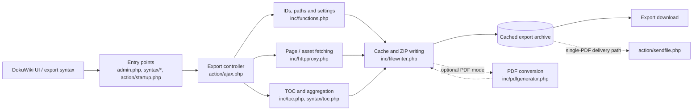

# SiteExport compatibility fork for DokuWiki Greebo

This repository is a compatibility fork of the DokuWiki **SiteExport** plugin by i-net software.

## Baseline

- Upstream: https://github.com/i-net-software/dokuwiki-plugin-siteexport
- Upstream tag: `2019-02-11`
- Upstream commit: `273152e01ed04ac93bce9b977005798185f42547`
- Tested DokuWiki: **2018-04-22b Greebo**
- Tested PHP: **5.6.40**

The purpose of this fork is to preserve a working SiteExport version for this legacy DokuWiki/PHP stack.

## Architecture

Explore the [interactive GitDiagram architecture map](https://gitdiagram.com/tomasgal/siteexport_dokuwiki_tg) for an overview of DokuWiki entry points, export processing, archive delivery, and PDF rendering.

### Runtime overview (Mermaid)

The diagram below summarizes the export paths represented in the source. DokuWiki entry points dispatch requests to the export controller, which collects pages and assets, resolves export paths, and writes a cached archive. PDF conversion is conditional on the optional mPDF/dw2pdf integration.

**Fork-specific compatibility points:** `syntax/toc.php` avoids resolving an already resolved TOC page ID a second time; `action/ajax.php` corrects link rewriting for flat exports with `userewrite=2`. These are targeted changes to the upstream export pipeline, not independent services. The dashed PDF path is optional and depends on the runtime's PDF support. The diagram describes the code structure; it is not a verified end-to-end test of every export mode.

The diagram is automatically generated and may omit implementation details. The fork-specific compatibility changes are documented in [Local compatibility fixes](#local-compatibility-fixes) below.

## Local compatibility fixes

Two source files differ from the upstream `2019-02-11` release:

1. `syntax/toc.php`
   - prevents an already resolved TOC page ID from being resolved a second time;
   - fixes cases where an already resolved root-page ID such as `docs` would otherwise become the invalid `docs:docs`.

2. `action/ajax.php`
   - fixes internal link rewriting for flat static exports with DokuWiki `userewrite=2`;
   - namespace-qualified links such as `docs/page` are rewritten to the actually exported flat file `page.html`.

The modified source locations contain explicit comments marking the changes and their date.

## License

This fork remains licensed under the **GNU General Public License version 2**, as the upstream project. Original copyright and license notices are retained.

## Original upstream README

The original documentation is available in the upstream repository and in the `2019-02-11` release history linked above.
